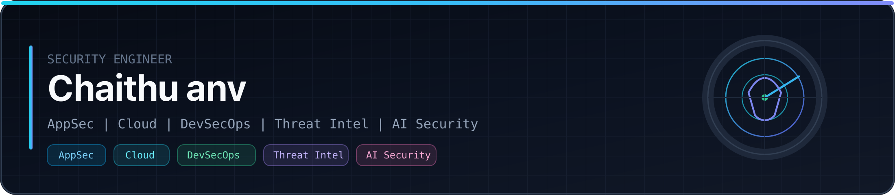

 

 

---

## About

I work security where software actually ships: AppSec reviews, cloud exposure, pipeline gates, and the intel side that tells you what matters next. Lately that also means **AI security** (how models get abused, and how to keep AI-assisted workflows from becoming a new attack surface).

Day to day I live in an AWS + Jenkins world. When a finding lands, I care less about the CVSS sticker and more about whether it is actually exploitable, why it exists, and how to explain the fix without drama. I am wrapping up a **Georgia Tech OMS Cybersecurity** degree (**December 2026**), with a capstone on an AI-powered threat intel pipeline. Off hours I am grinding VAPT toward **PNPT**, poking at LLM red-team patterns, and wiring bug-bounty recon so I spend less time babysitting tools.

| Domain | In practice |
|---|---|
| **AppSec** | SCA / SAST / API security, exploitability-first triage |
| **Cloud** | AWS exposure, GuardDuty / SIEM-adjacent signal |
| **DevSecOps** | Pipeline gates: Snyk, SonarCloud, Gitleaks, Trivy, Checkov, Akto |
| **Threat Intel** | Capstone work on AI-assisted collection and triage |
| **AI Security** | Prompt injection, LLM red-teaming, securing AI-assisted workflows |
| **Supply chain** | Dependency risk, package provenance, SCA beyond the scan badge |

---

## Currently focused on

- **Product security**: vulnerability remediation at scale and SCA / SAST / API-security tooling in CI/CD
- **OMS Cybersecurity (Georgia Tech)**: graduating **December 2026**; capstone on an AI-powered threat intel pipeline
- **AI security**: prompt injection, LLM red-teaming, and controls around AI-assisted systems 
- **Supply chain security**: dependency and package risk in the build path 
- **Chat intelligence**: turning noisy chat / alert streams into usable security signal 
- **VAPT / PNPT**: offensive practice toward PNPT 
- **Bug bounty recon automation**: Claude Code skills for a `subfinder → httpx → nuclei` pipeline 

<strong>How I triage</strong>

alert / finding → validate exploitability (not just the severity label) → find root cause → clear, neutral write-up

---

## Skills

  

 

| Daily driver | Building toward | Platform |
|:---|:---|:---|
|    |    |   |
|    |    |   |
|    |    |  |
|    |    |   |
|    |    |   |

---

## Selected projects

| Repo | Status | Description |
|---|---|---|
| [**AWS-Exposure-Monitor**](https://github.com/Chaithu5/AWS-Exposure-Monitor) |  | Read-only AWS internet-exposure monitor. Inventory for public EC2 / EIP, ELBv2, and RDS; fixed high-risk port reachability; resource attribution; run diffs (`NEW` / `CHANGED` / `RESOLVED`). Python, boto3, pytest. |
| [**portfolio-website**](https://github.com/Chaithu5/portfolio-website) |  | Personal site (HTML / CSS / JS / Bootstrap). [Pages](https://chaithu5.github.io/portfolio-website/). |

<strong>Earlier projects</strong>

| Repo | Description |
|---|---|
| [Sorting-Visualizer](https://github.com/Chaithu5/Sorting-Visualizer) | Visualizes bubble, insertion, selection, merge, and quick sort. |
| [DMA-project](https://github.com/Chaithu5/DMA-project) | World Happiness Index 2020: visualize, cluster, predict. |
| [Audiobook](https://github.com/Chaithu5/Audiobook) | PDF to speech (PyPDF2 / gTTS / Streamlit). |
| [Speech-to-Text](https://github.com/Chaithu5/Speech-to-Text) | Mic to text via SpeechRecognition. |
| [Face-Detection](https://github.com/Chaithu5/Face-Detection) | Minimal OpenCV face-detection demo. |
| [Public-Face-mask-Detection](https://github.com/Chaithu5/Public-Face-mask-Detection) | Mask detection with OpenCV + TensorFlow. |
| [Traffic-Sign-recognition](https://github.com/Chaithu5/Traffic-Sign-recognition) | Traffic-sign recognition. |
| [Electric-Billing-System](https://github.com/Chaithu5/Electric-Billing-System) | DBMS project (PHP). |
| [Simple-Chatbox-using-NLTK](https://github.com/Chaithu5/Simple-Chatbox-using-NLTK) | Small NLTK chatbot experiment. |

---

## Activity

  

---

## Contact

  
  

