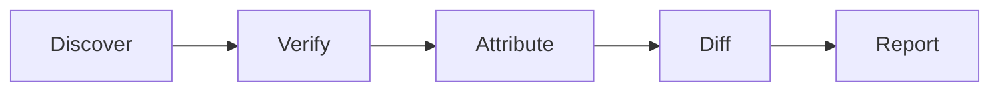

# Chaithu anv

**Security Engineer** — AppSec · Cloud Security · DevSecOps · Threat Intel

Building and hardening security programs on an AWS-centric stack with Jenkins CI/CD. Finishing a **Georgia Tech OMS Cybersecurity** degree (**graduating December 2026**; capstone: AI-powered threat intel pipeline). Off hours: VAPT study toward **PNPT** — in progress, applied AI × security, and automating bug-bounty recon with Claude Code.

---

## What I'm working on

### [AWS Exposure Monitor](https://github.com/Chaithu5/AWS-Exposure-Monitor)

Read-only continuous monitoring for internet-exposed AWS services. Discovers public assets in an owned account, checks a fixed high-risk port list, attributes each finding to the real resource (not just the security group), and diffs runs for `NEW` / `CHANGED` / `RESOLVED`.

- **Product security at scale** — vulnerability remediation and SCA / SAST / API-security tooling across the delivery pipeline.
- **OMS Cybersecurity (Georgia Tech)** — degree in progress, graduating **December 2026**; capstone: AI-powered threat intel pipeline.
- **VAPT / PNPT** — offensive practice toward PNPT .
- **Bug bounty recon automation** — Claude Code skills for a `subfinder → httpx → nuclei` pipeline .
- **Applied AI × security** — prompt injection, LLM red-teaming, securing AI-assisted systems .

<strong>Focus areas</strong>

| Area | How I spend time |
|---|---|
| AppSec / DevSecOps | SCA, SAST, secret scanning, pipeline gates (Snyk, SonarCloud, Gitleaks, Trivy, Checkov, Akto) |
| Cloud security | AWS exposure & misconfiguration; GuardDuty / SIEM-adjacent detection work |
| Threat intel | Capstone — AI-assisted collection / triage pipeline |
| Offense | VAPT lab work toward PNPT; Burp, nmap, Metasploit, BloodHound, nuclei |

---

## Skills

| Daily driver | Building toward | Platform |
|:---|:---|:---|
|    |    |   |
|    |   |   |
|    |   |  |
|    |  |   |

How I triage: alert/finding → validate exploitability (not just the severity label) → find root cause → clear, neutral write-up.

---

## Public work

Most of my day-to-day security work lives in private/employer repos — what's here is personal projects and practice.

| Repo | Description |
|---|---|
| [**AWS-Exposure-Monitor**](https://github.com/Chaithu5/AWS-Exposure-Monitor) | AWS internet-exposure monitor: inventory, high-risk port reachability, resource attribution, run diffs. |
| [**portfolio-website**](https://github.com/Chaithu5/portfolio-website) | Personal site (HTML/CSS/JS/Bootstrap) — [live](https://chaithu5.github.io/portfolio-website/). |

<strong>Earlier projects</strong>

| Repo | Description |
|---|---|
| [Sorting-Visualizer](https://github.com/Chaithu5/Sorting-Visualizer) | Visualizes bubble, insertion, selection, merge, and quick sort. |
| [DMA-project](https://github.com/Chaithu5/DMA-project) | World Happiness Index 2020 — visualize, cluster, predict. |
| [Audiobook](https://github.com/Chaithu5/Audiobook) | PDF → speech (PyPDF2 / gTTS / Streamlit). |
| [Speech-to-Text](https://github.com/Chaithu5/Speech-to-Text) | Mic → text via SpeechRecognition. |
| [Face-Detection](https://github.com/Chaithu5/Face-Detection) | Minimal OpenCV face-detection demo. |
| [Public-Face-mask-Detection](https://github.com/Chaithu5/Public-Face-mask-Detection) | Mask detection with OpenCV + TensorFlow. |
| [Traffic-Sign-recognition](https://github.com/Chaithu5/Traffic-Sign-recognition) | Traffic-sign recognition. |
| [Electric-Billing-System](https://github.com/Chaithu5/Electric-Billing-System) | DBMS project (PHP). |
| [Simple-Chatbox-using-NLTK](https://github.com/Chaithu5/Simple-Chatbox-using-NLTK) | Small NLTK chatbot experiment. |

---

## GitHub stats

---

## Contact

- GitHub: [@Chaithu5](https://github.com/Chaithu5)
- LinkedIn: [chaitanya-anv](https://www.linkedin.com/in/chaitanya-anv/)
