 

## Defender by role, attacker by curiosity

I'm a Security Engineer who protects cloud platforms, applications and APIs end to end. I build security into the development lifecycle, harden cloud infrastructure, run web application firewall programs, and create AI-driven automation that turns findings into fixes.

When I'm not chasing down a stubborn misconfiguration, I'm studying for my master's in Cybersecurity at Georgia Tech, hunting bugs on HackerOne, or reading about AI × security intersections.

<table>
  <tr>
    <td align="center" width="260"><h3>350+</h3>Pull requests shipped</td>
    <td align="center" width="260"><h3>8,000+</h3>Issues resolved</td>
    <td align="center" width="260"><h3>3+</h3>Years building</td>
  </tr>
</table>

## How I approach security

| | Principle | In practice |
|:-:|---|---|
| 01 | **Threat-Informed Defense** | Start from how attackers really operate. MITRE ATT&CK and threat intelligence shape what gets tested, monitored and hardened. |
| 02 | **Risk-Based Prioritization** | Severity is only the starting point. Exploitability, exposure, active exploitation and business impact decide what gets fixed first. |
| 03 | **Secure by Design** | Threat modeling, secure defaults and OWASP-aligned reviews catch weaknesses early, while they are still cheap to fix. |
| 04 | **Zero Trust and Least Privilege** | Verify every request, grant only the access that is needed, and design as though any single credential could be compromised. |
| 05 | **Defense in Depth** | Layer controls across code, pipeline, cloud, identity and runtime, so one gap never becomes a breach. |
| 06 | **Detect, Respond, Improve** | Automate the repeatable, keep people on judgment calls, and turn every finding and incident into a stronger, measurable control. |

## What I've built

| Project | The outcome |
|---|---|
| **Enterprise WAF Program** | Consistent edge protection across environments, with a repeatable onboarding process |
| **Snyk Automation at Scale** | AI-assisted dependency remediation with human review before every merge |
| **API Security Coverage Program** | APIs brought under measurable security coverage inside CI pipelines |
| **AI Threat Intelligence Pipeline** | Continuous reachability and freshness checks on threat signals, built solo as a Georgia Tech capstone |
| **DAST and VAPT Program** | Verified, actionable findings from dynamic scanning and penetration testing |
| **Cloud Threat Detection Tuning** | Higher-confidence alerts and a more consistent response process |

Full problem, action and result for each one is on [my portfolio](https://chaithu5.github.io/#projects).

### Open source

[**AWS-Exposure-Monitor**](https://github.com/Chaithu5/AWS-Exposure-Monitor): a read-only AWS internet-exposure monitor. It inventories public EC2, Elastic IP, load balancer and RDS resources, checks high-risk ports, attributes resources, and compares runs. Built with Python, boto3 and pytest.

## Toolkit

| Area | Technologies I've worked with |
|---|---|
| **Application Security** | Snyk · Trivy · SonarCloud · Gitleaks · Checkov |
| **API & Offensive Testing** | Akto · Burp Suite · OWASP ZAP · Invicti · Nmap · Metasploit · OpenVAS |
| **Cloud Security** | AWS Security Hub · AWS GuardDuty · AWS WAF · CloudFront · Azure · Google Cloud |
| **Detection & Response** | SIEM · SOAR · Endpoint Detection · Threat Intelligence |
| **DevSecOps & Automation** | Python · GitHub Actions · Jenkins · Terraform · Git · Grafana |
| **AI Security** | LLM Security · AI Agents · RAG · AI Red Teaming |
| **Research Lab** | Kali Linux · Linux · Wireshark · Ghidra · angr · Snort · Nuclei · sqlmap · ffuf · Amass · Hashcat · mitmproxy |

## Currently working on

| Focus | Status | Details |
|---|---|---|
| **VAPT / Pentest Reboot** | In progress | A six-month plan toward PNPT: web foundation, network, Active Directory, cloud and evasion |
| **AI × Security Sprint** | In progress | AI as a defensive tool, offensive tool, attack target, product to secure and security platform |
| **Bug Bounty Automation** | Starting | Recon, triage and manual validation with modular AI skills, starting with API-scope programs |

## Education and certifications

| Education | Period |
|---|---|
| **Georgia Institute of Technology**, M.S. Cybersecurity (OMSCY) | 2025 to 2027 |
| **SRM University**, B.Tech Computer Science and Engineering | 2019 to 2023 |

**Certifications:** Certified Ethical Hacker (CEH) · CompTIA Security+ · AWS Certified Security Specialty · AWS Certified Cloud Practitioner · Microsoft Azure Fundamentals

<strong>Earlier projects</strong>

 

| Project | Description |
|---|---|
| [Sorting-Visualizer](https://github.com/Chaithu5/Sorting-Visualizer) | Visualizes bubble, insertion, selection, merge and quick sort |
| [DMA-project](https://github.com/Chaithu5/DMA-project) | World Happiness Index 2020: visualize, cluster and predict |
| [Audiobook](https://github.com/Chaithu5/Audiobook) | PDF to speech with PyPDF2, gTTS and Streamlit |
| [Speech-to-Text](https://github.com/Chaithu5/Speech-to-Text) | Microphone to text with SpeechRecognition |
| [Face-Detection](https://github.com/Chaithu5/Face-Detection) | A minimal OpenCV face-detection demo |
| [Public-Face-mask-Detection](https://github.com/Chaithu5/Public-Face-mask-Detection) | Mask detection with OpenCV and TensorFlow |
| [Traffic-Sign-recognition](https://github.com/Chaithu5/Traffic-Sign-recognition) | Traffic sign recognition |
| [Electric-Billing-System](https://github.com/Chaithu5/Electric-Billing-System) | Database management project in PHP |
| [Simple-Chatbox-using-NLTK](https://github.com/Chaithu5/Simple-Chatbox-using-NLTK) | A small NLTK chatbot experiment |

 

**[See the full interactive portfolio → chaithu5.github.io](https://chaithu5.github.io)**

