### Hey, I'm Chaitanya 👋

Security engineer who likes turning repetitive security work into code. Here you'll find my tools and experiments.

### 📌 Featured repositories

<table>
  <tr>
    <td width="50%" valign="top">
      <h4><a href="https://github.com/Chaithu5/AWS-Exposure-Monitor">AWS-Exposure-Monitor</a></h4>
      
Read-only monitoring for internet-exposed AWS services: finds public assets, checks high-risk ports and shows what changed between runs.

      <code>Python</code> <code>boto3</code> <code>pytest</code>
    </td>
    <td width="50%" valign="top">
      <h4><a href="https://github.com/Chaithu5/Chaithu5.github.io">Chaithu5.github.io</a></h4>
      
An interactive Spider-Man and Jarvis themed site with hand-built SVG artwork, canvas effects and a secret scan before every deploy.

      <code>TypeScript</code> <code>React</code> <code>Tailwind</code>
    </td>
  </tr>
</table>

### 🛠️ Tools I work with

  

### 🕸️ Contributions

<picture>
  <source media="(prefers-color-scheme: dark)" srcset="https://raw.githubusercontent.com/Chaithu5/Chaithu5/output/snake-dark.svg" />
  <source media="(prefers-color-scheme: light)" srcset="https://raw.githubusercontent.com/Chaithu5/Chaithu5/output/snake.svg" />
  
</picture>

<strong>🗂️ Earlier projects</strong>

 

| Repository | What it does | Language |
|---|---|---|
| [Sorting-Visualizer](https://github.com/Chaithu5/Sorting-Visualizer) | Visualizes bubble, insertion, selection, merge and quick sort | JavaScript |
| [DMA-project](https://github.com/Chaithu5/DMA-project) | World Happiness Index 2020: visualize, cluster and predict | Jupyter |
| [Audiobook](https://github.com/Chaithu5/Audiobook) | PDF to speech with PyPDF2, gTTS and Streamlit | Python |
| [Speech-to-Text](https://github.com/Chaithu5/Speech-to-Text) | Microphone to text with SpeechRecognition | Python |
| [Face-Detection](https://github.com/Chaithu5/Face-Detection) | A minimal OpenCV face-detection demo | Python |
| [Public-Face-mask-Detection](https://github.com/Chaithu5/Public-Face-mask-Detection) | Mask detection with OpenCV and TensorFlow | Python |
| [Traffic-Sign-recognition](https://github.com/Chaithu5/Traffic-Sign-recognition) | Traffic sign recognition | Python |
| [Electric-Billing-System](https://github.com/Chaithu5/Electric-Billing-System) | Database management project | PHP |
| [Simple-Chatbox-using-NLTK](https://github.com/Chaithu5/Simple-Chatbox-using-NLTK) | A small NLTK chatbot experiment | Python |

